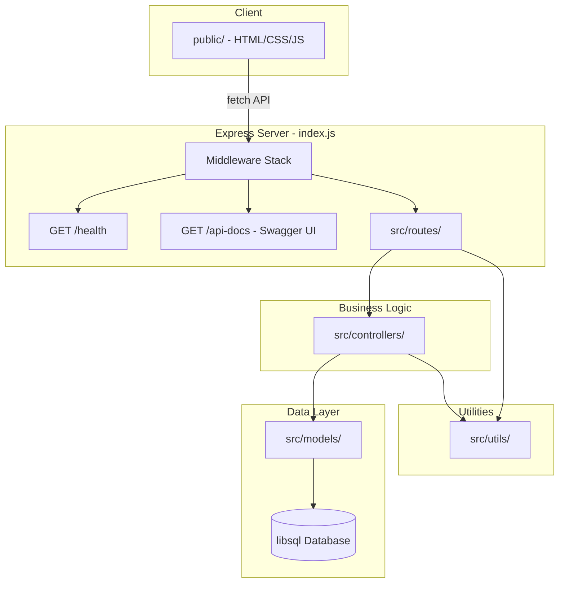
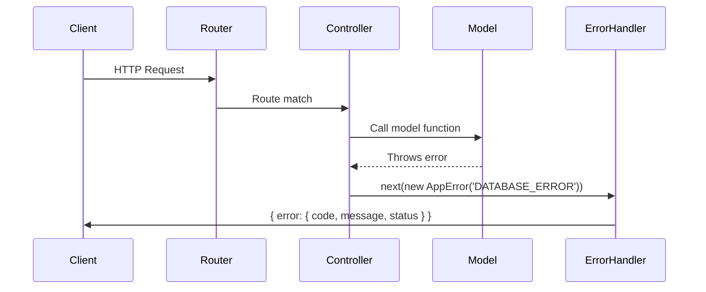

# Design Document: Student Assignment Template

## Overview

This design describes a base project template for 1st-year programming students building Express.js + libsql + Drizzle ORM backends with plain HTML/CSS/JS frontends. The template ships a working example feature (CRUD "tasks" endpoints, database schema, frontend page, tests) plus all tooling (dev server, database reset, validation, Swagger docs, linting) pre-configured so students can clone and start coding immediately.

The template is opinionated by design: ES Modules only, strict MVC separation, async/await everywhere, and beginner-readable code. Infrastructure files are marked as Protected_Files so students don't accidentally break the plumbing.

Key goals:
- Zero-config first run: `npm install` → `npm run dev` gets a working server with docs
- Clear example code that students copy and extend for their own features
- Guardrails (agents.md, protected file headers, validation script) that keep students on track
- Tutor-friendly tooling (Swagger docs, validation script, submission checklist)

## Architecture

The template follows a layered MVC architecture with clear separation of concerns.



### Request Flow

1. Client sends HTTP request
2. Express middleware stack processes it (CORS, JSON parsing, static files)
3. Router matches the route and delegates to the controller
4. Controller validates input, calls model functions, transforms data
5. Model executes Drizzle ORM queries against libsql
6. Response flows back through controller → router → client

### Directory Structure

```
project-root/
├── index.js                    # Express app setup, middleware, route registration
├── package.json                # Dependencies, scripts, "type": "module"
├── .env.example                # Environment variable template
├── .eslintrc.json              # ESLint configuration
├── drizzle.config.js           # Drizzle Kit configuration
├── GUIDE.md                    # Step-by-step feature development guide
├── README.md                   # Project documentation (serves as README example)
├── agents.md                   # AI guardrails file
├── requests.http               # REST Client API request collection
├── src/
│   ├── models/
│   │   └── exampleModel.js     # Drizzle schema + CRUD query functions
│   ├── controllers/
│   │   └── exampleController.js # Business logic + validation
│   ├── routes/
│   │   └── exampleRoute.js     # Route definitions
│   └── utils/
│       ├── database.js         # libsql + Drizzle client setup
│       └── errors.js           # Error codes, AppError class, error middleware
├── scripts/
│   ├── db.js                   # Database reset + seed (Protected_File)
│   ├── swagger.js              # Swagger-autogen config (Protected_File)
│   └── validate.js             # Project validation script (Protected_File)
├── tests/
│   └── example.test.js         # Example API endpoint tests
├── public/
│   ├── index.html              # Example frontend page
│   ├── components/             # Reusable UI components
│   ├── css/
│   │   └── style.css           # Example styles
│   └── js/
│       └── main.js             # Example fetch API calls
├── prompts/
│   ├── create-html-page.md     # Prompt template for HTML pages
│   ├── style-with-css.md       # Prompt template for CSS styling
│   ├── fetch-api-calls.md      # Prompt template for API integration
│   └── dom-events.md           # Prompt template for DOM event handling
├── .vscode/
│   ├── extensions.json         # Recommended extensions
│   └── settings.json           # Editor defaults
└── .github/
    └── PULL_REQUEST_TEMPLATE.md # Submission checklist
```

## Components and Interfaces

### 1. Entry Point — `index.js`

The main application file. Sets up Express, registers middleware, mounts routes, and exports the app for testing.

```javascript
// index.js
import express from 'express';
import cors from 'cors';
import { router as taskRoutes } from './src/routes/exampleRoute.js';
import { errorHandler } from './src/utils/errors.js';

const app = express();

// Middleware
app.use(cors());
app.use(express.json());
app.use(express.static('public'));

// Routes
app.get('/health', (req, res) => res.json({ status: 'ok' }));
app.use('/api/tasks', taskRoutes);

// Swagger docs (loaded from protected script)
// Registered in scripts/swagger.js and called on startup

// Global error handler (must be last)
app.use(errorHandler);

// Only listen when run directly (not imported for testing)
const PORT = process.env.PORT || 3000;
if (process.argv[1] === new URL(import.meta.url).pathname) {
  app.listen(PORT, () => {
    console.log(`Server running at http://localhost:${PORT}`);
    console.log(`API docs at http://localhost:${PORT}/api-docs`);
  });
}

export default app;
```

Design decisions:
- `app` is exported so supertest can import it without starting a listener
- The `process.argv[1]` check distinguishes direct execution from test imports
- Middleware order matters: CORS → JSON → static → routes → error handler

### 2. Models — `src/models/`

Models define Drizzle ORM schemas and export async CRUD functions. No HTTP concerns (no `req`/`res`).

Interface contract for any model file:
```javascript
// Schema definition using Drizzle's sqliteTable
export const tasks = sqliteTable('tasks', { ... });

// CRUD functions — all async, all return plain data
export async function getAll(db, filters) { ... }
export async function getById(db, id) { ... }
export async function create(db, data) { ... }
export async function update(db, id, data) { ... }
export async function remove(db, id) { ... }
```

The `db` parameter is the Drizzle client instance, injected from the utility module. This keeps models testable and decoupled from connection setup.

### 3. Controllers — `src/controllers/`

Controllers sit between routes and models. They handle input validation (via express-validator), call model functions, and format responses.

Interface contract:
```javascript
// Each controller function receives (req, res, next)
export async function getAllTasks(req, res, next) {
  // 1. Extract and validate query params
  // 2. Call model function
  // 3. Return formatted response or call next(error)
}
```

Controllers use `try/catch` with `next(error)` to delegate errors to the global error handler.

### 4. Routes — `src/routes/`

Routes define HTTP method + path mappings and wire them to controller functions. No business logic.

```javascript
import { Router } from 'express';
import { body } from 'express-validator';
import * as controller from '../controllers/exampleController.js';

export const router = Router();

router.get('/', controller.getAllTasks);
router.get('/:id', controller.getTaskById);
router.post('/', [body('title').notEmpty()], controller.createTask);
router.put('/:id', [body('title').notEmpty()], controller.updateTask);
router.delete('/:id', controller.deleteTask);
```

Validation rules are declared inline on the route using express-validator. The controller checks `validationResult(req)` and returns errors if present. Query parameter filtering (e.g., `?completed=true` or `?search=term`) is handled in the controller's `getAllTasks` function.

### 5. Utilities — `src/utils/`

#### `database.js` — Database Connection
```javascript
import { createClient } from '@libsql/client';
import { drizzle } from 'drizzle-orm/libsql';

const client = createClient({ url: process.env.DATABASE_URL || 'file:local.db' });
export const db = drizzle(client);
```

#### `errors.js` — Error Handling
```javascript
// Centralized error codes
export const ERROR_CODES = {
  VALIDATION_ERROR: { status: 400, message: 'Validation failed' },
  NOT_FOUND: { status: 404, message: 'Resource not found' },
  DATABASE_ERROR: { status: 500, message: 'Database error' },
  INTERNAL_ERROR: { status: 500, message: 'Internal server error' },
};

// Custom error class
export class AppError extends Error {
  constructor(code, details) { ... }
}

// Global error handler middleware
export function errorHandler(err, req, res, next) {
  // Returns { error: { code, message, status } }
}
```

### 6. Scripts — `scripts/` (All Protected_Files)

#### `scripts/db.js` — Database Reset & Seed
- Deletes existing database file if present
- Runs `drizzle-kit push` to create tables from schema
- Inserts seed data
- Protected_File header: `// DO NOT MODIFY THIS FILE - This file is managed by the template`

#### `scripts/swagger.js` — Swagger Auto-Generation
- Uses swagger-autogen to scan Express router files
- Generates swagger-output.json on server startup
- Mounts Swagger UI at `/api-docs`
- Protected_File

#### `scripts/validate.js` — Project Validation
- Checks required files/directories exist
- Verifies npm dependencies installed
- Starts server and checks `/health` responds
- Verifies Protected_File headers intact
- Outputs pass/fail summary, exits non-zero on failure
- Protected_File

### 7. Tests — `tests/`

Tests use Jest + Supertest. They import the app from `index.js` and make HTTP requests against it.

```javascript
import request from 'supertest';
import app from '../index.js';

describe('GET /api/tasks', () => {
  it('should return a list of tasks', async () => {
    const res = await request(app).get('/api/tasks');
    expect(res.status).toBe(200);
    expect(Array.isArray(res.body)).toBe(true);
  });
});
```

Jest configuration needs `--experimental-vm-modules` for ESM support, configured in package.json scripts.

### 8. Frontend — `public/`

Plain HTML/CSS/JS. No build tools, no frameworks. The `public/components/` directory holds reusable UI components (e.g., a shared header or task-item renderer). The example page demonstrates:
- Fetching data from the API using `async/await` with `fetch()`
- Rendering data to the DOM
- Submitting forms via POST requests
- Basic error display

### 9. Documentation & Support Files

| File | Purpose | Req |
|------|---------|-----|
| `README.md` | Project docs, serves as README example | 10.2 |
| `GUIDE.md` | Step-by-step feature development walkthrough | 17 |
| `agents.md` | AI guardrails for coding assistants | 19 |
| `requests.http` | REST Client API request collection | 18 |
| `prompts/*.md` | Frontend AI prompt templates | 20 |
| `.github/PULL_REQUEST_TEMPLATE.md` | Submission checklist | 16 |
| `.vscode/extensions.json` | Recommended VS Code extensions | 13.3 |
| `.vscode/settings.json` | Editor defaults (format on save, tab size) | 13.6 |
| `.env.example` | Environment variable template | 9.1 |

## Data Models

The template includes an example schema demonstrating Drizzle ORM usage with libsql. The example uses a simple task-list domain with a single table.

### Example Schema

```javascript
import { sqliteTable, text, integer } from 'drizzle-orm/sqlite-core';

export const tasks = sqliteTable('tasks', {
  id: integer('id').primaryKey({ autoIncrement: true }),
  title: text('title').notNull(),
  completed: integer('completed', { mode: 'boolean' }).notNull().default(false),
  createdAt: text('created_at').notNull().default(new Date().toISOString()),
});
```

### Seed Data Structure

The `scripts/db.js` seed function inserts sample records:

```javascript
const seedTasks = [
  { title: 'Buy groceries', completed: false },
  { title: 'Read a book', completed: true },
  { title: 'Go for a walk', completed: false },
];
```

### Database Configuration

| Setting | Value |
|---------|-------|
| Engine | libsql (SQLite-compatible) |
| ORM | Drizzle ORM |
| Schema push | `drizzle-kit push` (no migration files) |
| Connection | `file:local.db` (default, configurable via `DATABASE_URL`) |
| File location | Project root (`local.db`) |

### Environment Variables

| Variable | Default | Purpose |
|----------|---------|---------|
| `PORT` | `3000` | Server port |
| `DATABASE_URL` | `file:local.db` | libsql connection string |
| `NODE_ENV` | `development` | Environment mode |

### package.json Scripts

| Script | Command | Purpose |
|--------|---------|---------|
| `dev` | `nodemon index.js` | Start dev server with auto-reload |
| `test` | `node --experimental-vm-modules node_modules/.bin/jest` | Run tests with ESM support |
| `db` | `node scripts/db.js` | Reset database and seed |
| `start:fresh` | `npm run db && npm run dev` | Reset DB then start dev server |
| `validate` | `node scripts/validate.js` | Run project validation checks |
| `lint` | `eslint .` | Run ESLint |

## Correctness Properties

*A property is a characteristic or behavior that should hold true across all valid executions of a system — essentially, a formal statement about what the system should do. Properties serve as the bridge between human-readable specifications and machine-verifiable correctness guarantees.*

### Property 1: Structured error responses

*For any* error thrown inside a route handler or controller, the global error handler middleware should catch it and return a JSON response with the shape `{ error: { code, message, status } }` where `code` is a non-empty string, `message` is a non-empty string, and `status` is a valid HTTP status code (100–599).

**Validates: Requirements 8.1**

### Property 2: Error code map completeness

*For any* error code defined in the ERROR_CODES map, it should map to an object containing a `status` field with a valid HTTP status code (100–599) and a `message` field with a non-empty string.

**Validates: Requirements 8.6**

### Property 3: Protected file headers match exact format

*For any* file designated as a Protected_File (scripts/db.js, scripts/swagger.js, scripts/validate.js), the first line should be exactly `// DO NOT MODIFY THIS FILE - This file is managed by the template`.

**Validates: Requirements 21.1, 21.2**

### Property 4: Validation script detects missing protected file headers

*For any* Protected_File where the do-not-modify header has been removed or altered, the Validation_Script should report a warning for that file in its output.

**Validates: Requirements 21.3**

### Property 5: Validation script reports pass/fail and exits correctly

*For any* set of validation checks, the Validation_Script output should list each check with a pass or fail status, and if any check fails, the script should exit with a non-zero exit code.

**Validates: Requirements 15.4, 15.5**

### Property 6: Validation script checks all required files

*For any* file or directory in the required structure checklist, the Validation_Script should verify its existence and report it as present or missing.

**Validates: Requirements 15.1**

### Property 7: MVC separation — models have no HTTP concerns

*For any* file in the src/models/ directory, it should not import or reference Express, `req`, `res`, or any HTTP-related modules. Models should only contain schema definitions and data access functions.

**Validates: Requirements 10.4**

### Property 8: Example files contain guided TODO comments

*For any* example file (exampleModel.js, exampleController.js, exampleRoute.js), it should contain at least one inline comment matching the pattern `// TODO:` indicating where students should extend the code.

**Validates: Requirements 1.11**

### Property 9: Example functions have JSDoc comments

*For any* exported function in the example files (exampleModel.js, exampleController.js), it should be preceded by a JSDoc comment block (`/** ... */`).

**Validates: Requirements 10.3**

### Property 10: Async functions use async/await

*For any* exported function in models and controllers that performs asynchronous operations (database queries, etc.), it should be declared with the `async` keyword and use `await` for asynchronous calls rather than raw Promise chains.

**Validates: Requirements 10.6**

## Error Handling

### Strategy

The template uses a layered error handling approach designed for beginner readability:

1. **Controller-level try/catch**: Each controller function wraps its logic in `try/catch` and calls `next(error)` on failure
2. **AppError class**: A custom error class that carries an error code, message, and HTTP status
3. **Global error handler middleware**: Registered last in the middleware stack, catches all errors and returns the structured response
4. **Error codes map**: A centralized `ERROR_CODES` object mapping code strings to default status/message pairs

### Error Response Format

All error responses follow this structure:

```json
{
  "error": {
    "code": "VALIDATION_ERROR",
    "message": "Title field is required",
    "status": 400
  }
}
```

### Error Codes

| Code | HTTP Status | Default Message |
|------|-------------|-----------------|
| `VALIDATION_ERROR` | 400 | Validation failed |
| `NOT_FOUND` | 404 | Resource not found |
| `DATABASE_ERROR` | 500 | Database error |
| `INTERNAL_ERROR` | 500 | Internal server error |

### Error Flow



### Validation Errors

Input validation uses express-validator. When validation fails, the controller checks `validationResult(req)` and returns a 400 response with the validation errors mapped to the standard error format.

### Database Errors

Database errors from libsql/Drizzle are caught in controllers, logged to console, and wrapped in an `AppError` with code `DATABASE_ERROR` before being passed to `next()`.

### Unhandled Errors

Any error not explicitly caught by controllers is caught by the global error handler, which defaults to `INTERNAL_ERROR` (500) if the error doesn't have a recognized code.

## Testing Strategy

### Dual Testing Approach

The template uses two complementary testing strategies:

1. **Unit/Integration Tests (Jest + Supertest)**: Verify specific examples, edge cases, and integration points
2. **Property-Based Tests (fast-check)**: Verify universal properties across randomly generated inputs

Both are necessary — unit tests catch concrete bugs with specific examples, property tests verify general correctness across many inputs.

### Test Configuration

- **Framework**: Jest with `--experimental-vm-modules` for ESM support
- **HTTP Testing**: Supertest (imports app from index.js without starting listener)
- **Property Testing Library**: fast-check (minimum 100 iterations per property test)
- **Test Location**: `tests/` directory at project root

### Unit Test Coverage

Unit tests should cover:

- **Health endpoint**: GET /health returns 200 with JSON body (Req 14.3, 14.4)
- **CRUD endpoints**: GET, POST, PUT, DELETE on /api/tasks return correct status codes and data (Req 12.1, 12.2)
- **Validation rejection**: POST/PUT with invalid body returns 400 (Req 12.3)
- **Query parameters**: GET with `?completed=true` or `?search=term` filters correctly (Req 12.5)
- **404 handling**: GET /api/tasks/:id with non-existent ID returns 404 (Req 8.1)
- **Static files**: GET / returns HTML from public/ (Req 7.1)
- **Swagger docs**: GET /api-docs returns 200 (Req 3.2)
- **Database reset**: Running db.js creates tables and seeds data (Req 6.1–6.4)

### Property-Based Test Coverage

Each property test must reference its design document property with a comment tag.

| Property | Test Description | Tag |
|----------|-----------------|-----|
| Property 1 | Generate random AppError instances, pass through error handler, verify response shape | `Feature: student-assignment-template, Property 1: Structured error responses` |
| Property 2 | Iterate all ERROR_CODES entries, verify each has valid status and non-empty message | `Feature: student-assignment-template, Property 2: Error code map completeness` |
| Property 3 | Read first line of each Protected_File, verify exact header match | `Feature: student-assignment-template, Property 3: Protected file headers match exact format` |
| Property 5 | Run validation with random subsets of files missing, verify output format and exit code | `Feature: student-assignment-template, Property 5: Validation script reports pass/fail and exits correctly` |
| Property 6 | Remove random required files, run validation, verify each missing file is reported | `Feature: student-assignment-template, Property 6: Validation script checks all required files` |
| Property 7 | Parse all files in src/models/, verify no HTTP-related imports | `Feature: student-assignment-template, Property 7: MVC separation` |
| Property 8 | Scan example files for TODO comments | `Feature: student-assignment-template, Property 8: Example files contain guided TODO comments` |
| Property 9 | Parse example files, find exported functions, verify JSDoc presence | `Feature: student-assignment-template, Property 9: Example functions have JSDoc comments` |
| Property 10 | Parse model/controller files, find async functions, verify await usage | `Feature: student-assignment-template, Property 10: Async functions use async/await` |

### Test File Organization

```
tests/
├── example.test.js          # Unit/integration tests for example CRUD endpoints
├── health.test.js            # Health endpoint tests
├── errors.test.js            # Error handling unit tests
└── properties.test.js        # Property-based tests for correctness properties
```

### Running Tests

```bash
# Run all tests
npm run test

# Run with verbose output
npm run test -- --verbose
```

Jest is configured in package.json with `--experimental-vm-modules` to support ES Modules. Tests import the app directly and use supertest to make requests without starting a real server.
